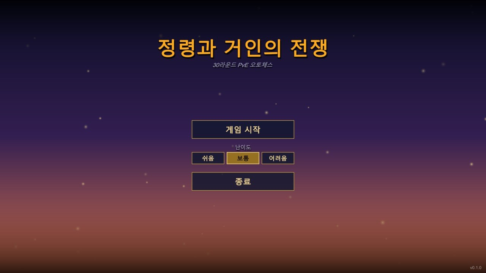
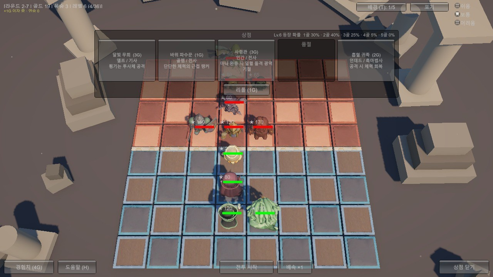
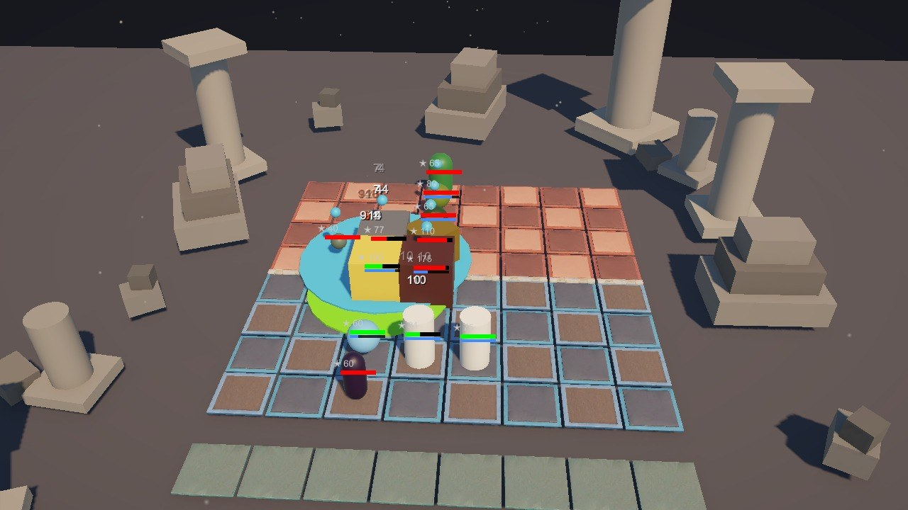
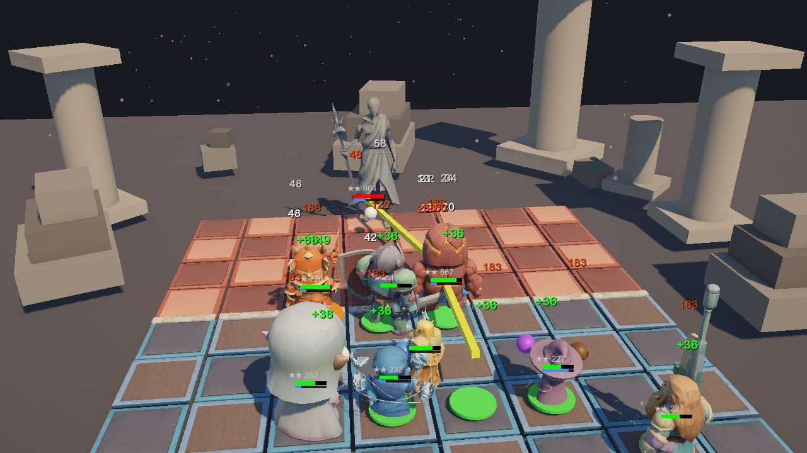

# 정령과 거인의 전쟁 (Spirits & Giants)

> 가제. 8×8 전장에서 유닛을 사고 합성해 30라운드를 버티는 **PvE 오토체스**. Unity 6 (URP) · C#



## 한눈에 보기

- **30라운드 PvE**: 스테이지 3개 × 10라운드, 목숨 3개. 10·20·30라운드는 보스(바위 파수꾼 → 메두사 여왕 → 제우스)
- **유닛 40종**: 코스트 1~5, 종족 14 × 직업 10 시너지(2/4/6종 활성화), 액티브 스킬 25종
- **성장 시스템**: 상점 구매 · 리롤 · 경험치(출전 한도) · 같은 유닛 3개 → ★ 합성(최대 ★★★) · 이자·연승 골드
- **난이도 3단계**(쉬움/보통/어려움), 전투 배속 ×1/×2/×3, 도움말(H)
- **배경 테마 5종**(T 키): 투기장 / 정령의 숲 / 부유 섬 / 화산·얼음 / 별빛 신전
- **자동 시연 모드**: 게임이 스스로 플레이하며 카메라가 움직이는 트레일러용 모드

| 상점·배치 | 전투 | 보스전 |
|---|---|---|
|  |  |  |

## 플레이 방법

1. 상점(오른쪽 아래 `상점 열기`)에서 유닛을 사면 아래 **대기석**에 생긴다. 클릭하거나 끌어서 **내 진영(아래 4줄)** 에 배치한다.
2. 출전 한도는 **레벨**과 같다. 라운드가 끝나면 경험치 +2, `경험치 (4G)` 로 +4를 살 수 있다.
3. `전투 시작` → 유닛들이 자동으로 싸운다. 이기든 지든 골드를 받고 다음 라운드로 넘어간다. 지면 목숨이 1 줄어든다.
4. 같은 유닛 3개를 모으면 자동 합성(★ 상승). 같은 종족·직업을 모으면 시너지 보너스.
5. 3-10 보스를 쓰러뜨리면 클리어.

| 키 | 동작 |
|---|---|
| `H` | 도움말 |
| `T` | 배경 테마 전환 |
| `M` | 소리 켜기/끄기 |
| `ESC` | 팝업 닫기 |

## 실행하기

**플레이만 하려면**: [Releases](../../releases)의 `SpiritsAndGiants_Windows.zip` 을 받아 압축을 풀고 `SpiritsAndGiants.exe` 실행 (Windows 64bit).

**소스에서 실행**: Unity **6000.3.21f1** 으로 프로젝트를 열고 `Assets/Scenes/MainMenu.unity` 를 연 뒤 Play.
(`Assets/Scenes/GameScene.unity` 에서 바로 시작해도 된다.)

### 난이도 시험 모드 (개발용)

```
SpiritsAndGiants.exe -batchmode -nographics -sim 40 -logFile sim.log
```
화면 없이 봇이 난이도 3종을 각 40판 돌려 라운드별 승률을 로그(`[SIM]` 줄)에 남긴다. 몇 초면 끝난다. 적 구성(`StageManager.Waves`)을 바꾼 뒤 바로 측정할 때 쓴다.

### 자동 시연(트레일러) 모드

```
SpiritsAndGiants.exe -demo
SpiritsAndGiants.exe -demo -capture TrailerFrames -fps 30 -screen-width 1280 -screen-height 720 -screen-fullscreen 0
```
`-capture` 는 프레임을 고정 간격으로 JPG 저장한다. 이후 Blender 로 MP4 변환: [Tools/make_trailer.py](Tools/make_trailer.py)

## 프로젝트 구조

| 경로 | 내용 |
|---|---|
| `Assets/Scripts/AutoChess.cs` | 게임 본체: 유닛 DB, 전투 틱, 30라운드 스테이지 표, 상점, 합성, 시너지, 정산, UI (IMGUI) |
| `Assets/Scripts/AutoChessDemo.cs` | 자동 시연 모드 + 프레임 저장 |
| `Assets/Scripts/AutoChessThemes.cs` | 맵 주변 배경 테마 5종 (소품 FBX 가 없으면 도형 임시 소품) |
| `Assets/Scripts/AutoChessVisualManager.cs` | 3D 유닛·타일 연결 (에셋이 없으면 기본 도형으로 대체) |
| `Assets/Scripts/MainMenu.cs` | 메인 메뉴 씬 |
| `Assets/Editor/` | 비주얼 에셋 자동 매칭, 텍스처 추출·적용, 메뉴 이미지 임포터 |
| `Tools/` | Blender 모델 정리(`clean_units.py`), 트레일러 변환(`make_trailer.py`) |
| `Docs/` | 인수인계 문서, 바르코 3D 프롬프트 가이드 |

## 제작 파이프라인 (AI 생성 에셋 → 게임)

3D 유닛·타일은 **바르코 3D(텍스트→3D)** 로 생성했고, 그대로는 면 50만 개·56MB 라서 **Blender 일괄 스크립트**로 정리한다.

```
바르코 3D (FBX 50만 면, 4096px)  →  Tools/clean_units.py (Blender)  →  6천 면 FBX + 1024px JPG  →  Unity 메뉴로 재질 자동 연결
```

- 면 수 50만 → 6천, 파일 56MB → 0.3MB, 게임 화면에서는 차이가 거의 없다.
- 사용법: [Tools/README_모델정리.md](Tools/README_모델정리.md)

## 에셋에 대해

바르코 3D 로 생성한 **3D 유닛·타일 모델과 텍스처는 이 저장소에 포함하지 않았다**(생성 서비스 약관 확인 전). 모델이 없어도 게임은 실행되며 해당 유닛은 도형으로 표시된다.
모델이 들어간 완성 화면은 위 스크린샷과 [Releases](../../releases)의 빌드(zip)에서 볼 수 있다. 모델을 직접 만들어 넣는 방법은 [Tools/README_모델정리.md](Tools/README_모델정리.md)와 `Docs/Varco3D_초보자_가이드.md` 참고.
효과음 파일도 포함하지 않았다(없으면 소리 없이 실행).

## 현재 상태와 계획

- 유닛 40종(+소환 유령) 3D 모델 연결 완료(저장소에는 미포함, 위 "에셋에 대해" 참고). 배경 테마의 소품은 아직 임시 도형이다.
- 밸런스: 시험 모드의 단순한 봇 기준으로 40판 중 쉬움 24판·보통 9판·어려움 5판을 클리어한다. 사람 기준 난이도는 점검 중.
- 효과음(공격·스킬·버튼·사망 등)은 구현됨. 단, 소리 파일은 저작권 때문에 저장소에 포함하지 않았다(없으면 소리 없이 실행). 배경음악은 없음.
- 예정: 배경음악, 해상도에 맞춘 UI 크기, 사망·등장 연출.

## 라이선스

소스 코드는 [MIT License](LICENSE). 바르코 3D 로 생성한 모델·텍스처 등 **에셋은 코드 라이선스에 포함되지 않으며**, 각 생성 서비스의 이용 약관을 따른다.
